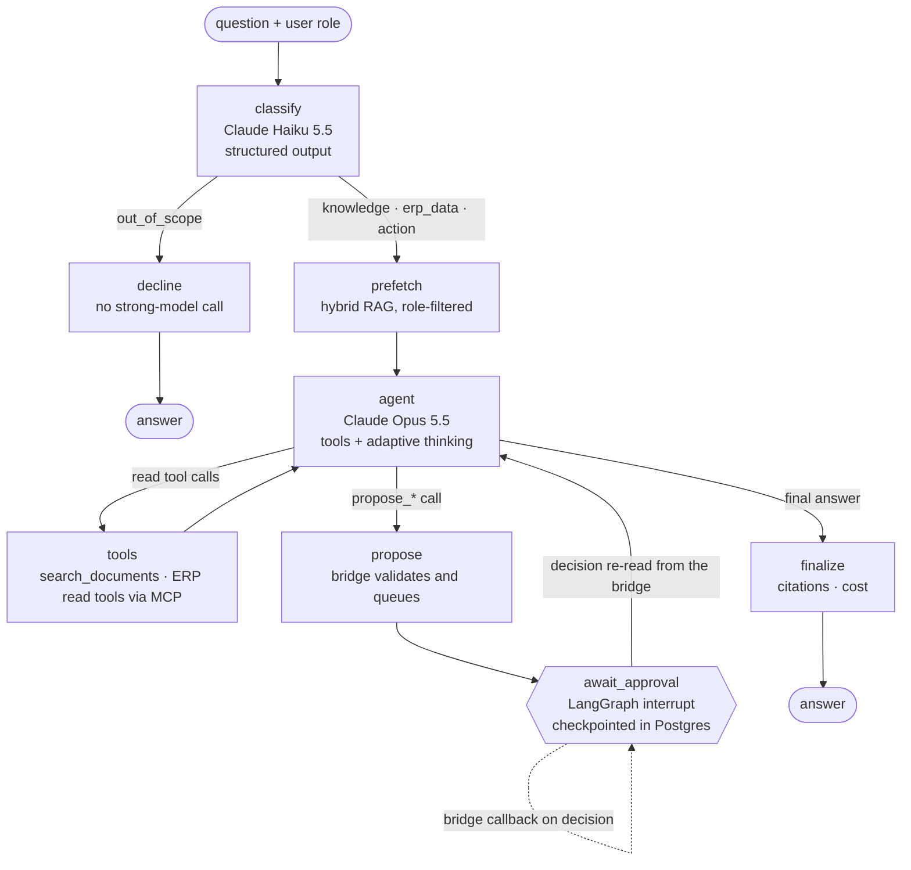

# Ops Copilot Agent

[](https://github.com/OWNER/ops-copilot-agent/actions/workflows/ci.yml)
[](evals/results)
 

**The problem.** Operations people at a manufacturer-distributor-retailer spend their day answering the same two kinds of question: "what does the policy say?" (returns, credit hold, approval limits) and "what do the numbers say?" (stock at KLCC, overdue invoices, last quarter's sales by channel). This agent answers both, with citations and live ERP data, and drafts the purchase order, transfer or production run when one is needed, which a person then approves before anything is written.

> Part of a three-repo showcase for **Tembusu Housewares**, a fictional Malaysian housewares manufacturer and retailer. The agent's ERP tools come from [erp-mcp-bridge](../erp-mcp-bridge); see also [invoice-flow](../invoice-flow).

## Architecture



- **Two models, two jobs.** A cheap model routes every question with a Pydantic-typed output; the strong model only runs when there's real work. Out-of-scope requests never reach it.
- **Retrieval**: 202 synthetic company documents (policies, SOPs, price lists, product sheets, QC specs, supplier and site profiles, meeting minutes, incident reports), heading-aware chunking (tables split by row with the header repeated), **pgvector + Postgres full-text search fused with reciprocal rank fusion**, then a **cross-encoder reranker**. Embeddings and reranker are local ONNX models (`bge-small-en-v1.5`, `ms-marco-MiniLM-L-6-v2`) baked into the image; Cohere Rerank is a config switch.
- **Permission-aware retrieval**: every chunk carries its document's audience; the role filter is inside the SQL, so a store manager's question can never retrieve the confidential customer account notes or the management store review.
- **ERP tools over MCP** from the bridge. When the caller passes the user's own bridge token, the user's scopes apply (a KLCC store manager's agent sees only KLCC).
- **Human-in-the-loop that survives restarts.** Proposing pauses the run with a LangGraph `interrupt`, checkpointed in Postgres. The bridge calls back when a person decides; the run resumes, re-reads the decision from the bridge (it never trusts the callback body), and reports the ERP reference.
- **Cost per run** from token usage × price table, per model, on every response and in Langfuse traces.

## Example

Illustrative: the ERP values and the refusal are real (from the live-bridge test against the seeded Odoo); the wording of the answers is what the prompt asks for, not a recorded model output.

```text
POST /v1/chat  {"question": "KLCC is almost out of air fryers. Move enough from the DC to get it back to max.",
                "user": {"id": "aisyah", "role": "store_manager"}}

-> status: awaiting_approval
   "I've proposed: Transfer DC -> KLCC: 35 x TH-SA-6104. Nothing has been written to the ERP yet..."
   (KLCC has 2 against a max of 40, but the DC has only 35 available: the bridge would have refused 38.)

   ...approver clicks Approve on the bridge's approval page...

GET /v1/runs/{thread_id}
-> status: completed
   "Done: the transfer was approved by Aisyah Rahman and created in Odoo as DC/INT/00005. KLCC will have 37
    air fryers after Friday's truck [S1]. ..."
```

## Evals

[`evals/cases.yaml`](evals/cases.yaml) has **100 cases** written against the seeded ERP and the document set:

| Category | Cases | What is checked |
|---|---|---|
| knowledge | 40 | facts present, the right document cited, no writes |
| erp_data | 25 | the right tools called, the right numbers in the answer |
| action | 15 | the right `propose_*` tool with the right arguments; impossible requests refused with the reason |
| permission | 10 | restricted documents and ERP data never leak to roles without access |
| out_of_scope | 10 | declined, including prompt-injection and "approve it yourself" attempts |

Two layers, both in CI:

1. **Retrieval evals on every PR** (no API key): hit@5 and MRR for the 43 document-grounded questions with the real embedder and reranker, plus a permission-leak sweep over all 100 questions × 3 restricted roles. The PR fails if hit@5 drops below 85%. Offline keyword-only baseline (hashing embedder, no reranker): **hit@5 86%, MRR 0.75**.
2. **Agent evals nightly and on demand** (`agent-evals.yml`): boots the bridge and seeded Odoo, runs all 100 cases against the real models, rejects every proposal it creates so the ERP is untouched, commits `evals/results/*.md` and the README badge.

```bash
python -m evals.run_evals                                     # default routing
python -m evals.run_evals --label strong-only --cheap claude-opus-5-5
```

The badge reads "not run yet" until the first agent-eval run with an `ANTHROPIC_API_KEY` secret.

### Model routing: what the cheap model saves

| Per run (estimate) | Routed (Haiku classifies, Opus reasons) | Opus does everything |
|---|---|---|
| classification | ~$0.00005 | ~$0.002 + thinking |
| out-of-scope request | ~$0.00005 total | ~$0.002 + a strong-model turn if misrouted |
| typical answered question (2–3 Opus calls, cached prefix) | ~$0.02–0.04 | same + ~$0.002 |

These are estimates from the price table in [`pricing.py`](src/ops_copilot/pricing.py). The measured numbers come from running both labels above; `evals/results/default.md` and `strong-only.md` report score, total cost, cost per run and p50/p95 latency side by side.

## Run it

```bash
git clone .../erp-mcp-bridge ../erp-mcp-bridge
cp .env.example .env            # ANTHROPIC_API_KEY; optional LANGFUSE_* keys
docker compose up -d            # bridge stack + pgvector + the copilot (first run seeds Odoo, ~15 min)
curl -s localhost:8100/v1/chat -H 'content-type: application/json' \
  -d '{"question":"Which raw materials at the factory need reordering?","user":{"id":"me","role":"management"}}'
```

API docs at http://localhost:8100/docs. Approve proposals at http://localhost:8000/approvals.

**Tracing**: set `LANGFUSE_PUBLIC_KEY`, `LANGFUSE_SECRET_KEY` and `LANGFUSE_BASE_URL` (Langfuse Cloud, or a self-hosted Langfuse from its official compose file). Each run is one trace with the classification, retrieval, every tool call and every model generation with tokens and USD cost; the trace URL is returned on the run.

## Tests

```bash
pip install -e ".[dev]"
pytest -q                                              # graph, API, scoring, retrieval evals (offline)
BRIDGE_URL=http://localhost:8000 pytest tests/test_live_bridge.py   # against the running bridge + Odoo
```

The graph tests drive every branch with a scripted model: citations, out-of-scope with no strong-model call, tool loops, write tools hidden outside the action route, pause → spurious resume (ignored) → decision → resume, rejection, bridge validation errors fed back to the model, one proposal per step, the user's token forwarded, role-filtered search, the step limit. The live test runs the full loop against real Odoo: MCP over HTTP, a real proposal, approval through the bridge API, the Odoo write, and the paused run resuming with the ERP reference.

## What I'd do next

- Run the agent evals with a real key and tune the prompts on the failures (with a train/test split).
- Semantic caching of frequent policy questions.
- The Approval Console (frontend team) on top of `/v1/runs` and the bridge's `/api/actions`.
- Per-user delegated tokens from the company IdP instead of passing bridge tokens through.

---

Built by [Your Name], Backend Engineer at Devs Core — [devs-core.com](https://devs-core.com). MIT licence. All company, supplier and customer names are fictional.
